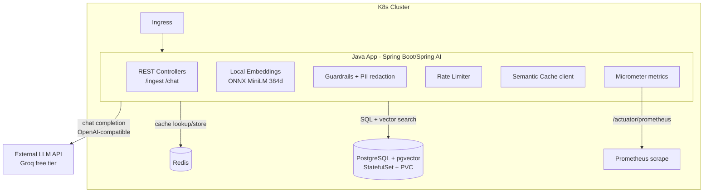

# Implementation Plan — Production-Ready RAG App (Spring AI + pgvector + Helm/K8s)

## Problem Statement
Build a production-ready RAG application from scratch on Java/Spring AI with vector search (pgvector), document upload over REST, an external chat model (OpenAI-compatible API with a free tier), and local embeddings. Everything is packaged into a single Helm chart for a full Kubernetes cluster (persistent storage, ingress, secrets), with a complete set of production features: semantic caching, PII redaction, guardrails, rate limiting, and token/latency metrics.

## Requirements (confirmed)
- LLM: external OpenAI-compatible API with a free tier (e.g. Groq — `base-url=https://api.groq.com/openai/v1`, model such as `llama-3.3-70b`), key supplied via a K8s Secret.
- Embeddings: local, computed in-process (Spring AI Transformers/ONNX, `all-MiniLM-L6-v2`, 384 dimensions) — free, and PII never leaves the cluster.
- Ingestion: REST file upload (PDF/txt/md) → parse (Tika) → chunking → embeddings → pgvector.
- K8s: full cluster — PVC for the database, Ingress, Secrets.
- Production: semantic caching (Redis), PII redaction on input, guardrails (prompt-injection + output filter), rate limiting, metrics (Micrometer + Prometheus).
- Stack: Spring Boot 3.3+, Java 21, Maven, Spring AI 1.0.x, multi-stage Dockerfile.

## Background (research)
- Spring AI 1.0 GA provides starters: `spring-ai-starter-model-openai` (configurable `base-url` → works with Groq/OpenRouter/any OpenAI-compatible endpoint), `spring-ai-transformers` (local ONNX embeddings), `spring-ai-starter-vector-store-pgvector`, `spring-ai-tika-document-reader` (PDF/docx/html parsing), `TokenTextSplitter` (chunking).
- The vector dimension in the pgvector schema must match the embedding model: `all-MiniLM-L6-v2` = 384 (not 1536 as with OpenAI). This is a critical config.
- pgvector on K8s: image `pgvector/pgvector:pg16` (StatefulSet + PVC), extension `CREATE EXTENSION vector` — the Spring AI pgvector starter can initialize the schema automatically (`initialize-schema=true`).
- Semantic caching: store a (query embedding → response) pair in Redis; on a new query, find the nearest vector above a cosine-similarity threshold → return the cached response, saving tokens and latency.
- Testcontainers (postgres with pgvector + redis) for integration tests without external dependencies.
- Security: the external API key only via a Secret (never in values in plaintext); Ingress has no auth by default — this is explicitly flagged, and we add at least rate limiting plus an optional basic-auth/network-policy hook.
- Helm chart reference: a production-style Helm chart with per-component image blocks. Conventions we adopt: per-component image blocks so every image is overridable (`<component>.image.registry/repository/name/tag/pullPolicy`), a `global` block for cross-cutting registry/pullSecret/storageClass overrides, per-component `resources`/`probes`/`service`/`persistence` maps, named-template helpers in `_helpers.tpl` (image path composition, labels, selector labels, product annotations), a `values.schema.json` for validation, hardened container `securityContext` (runAsNonRoot, readOnlyRootFilesystem, drop ALL caps), and `metrics`/`networkPolicy` toggles.

## Helm Chart Design (flexible, fully overridable values)

Single chart `charts/sestacon` deploying three components (Java app, PostgreSQL+pgvector, Redis), each independently toggleable and fully overridable. Image coordinates are split (`registry` / `repository` / `name` / `tag` / `pullPolicy`) in a per-image map, so e.g. `postgres.image.name` or `postgres.image.tag` can be overridden on their own. A `global` block overrides registry/pullSecret/storageClass across all components. The chart composes the full image path via an `imagePath` helper in `_helpers.tpl` (registry/repository/name:tag, with `global.registry.url` override).

Target `values.yaml` layout:

```yaml
global:
  registry:
    url: ""              # overrides every component's image.registry when set
  pullSecret: ""         # imagePullSecret name applied to all pods
  imagePullPolicy: IfNotPresent
  storageClass: ""       # overrides persistence.storageClass everywhere

nameOverride: ""
replicaCount: 1

# ---- Java RAG app ----
app:
  image:
    registry: docker.io
    repository: your-org
    name: Sestacon
    tag: ""              # defaults to Chart.appVersion when empty
    pullPolicy: IfNotPresent
  service:
    type: ClusterIP
    port: 8080
  config:
    llm:
      baseUrl: "https://api.groq.com/openai/v1"
      model: "llama-3.3-70b-versatile"
    embedding:
      model: "all-MiniLM-L6-v2"
      dimensions: 384
    cache:
      similarityThreshold: 0.95
    rateLimit:
      requestsPerMinute: 60
  secrets:
    llmApiKey:
      existingSecret: ""   # name of a pre-created Secret holding the API key
      key: "api-key"       # key within that Secret
  resources:
    requests: { cpu: 250m, memory: 1Gi }
    limits:   { cpu: "2",  memory: 2Gi }
  probes:
    liveness:  { initialDelaySeconds: 30, periodSeconds: 10, timeoutSeconds: 5, failureThreshold: 3 }
    readiness: { initialDelaySeconds: 20, periodSeconds: 10, timeoutSeconds: 5, failureThreshold: 3 }

# ---- PostgreSQL + pgvector ----
postgres:
  enabled: true
  image:
    registry: docker.io
    repository: pgvector
    name: pgvector
    tag: "pg16"
    pullPolicy: IfNotPresent
  auth:
    database: ragdb
    username: rag
    existingSecret: ""     # if set, password read from it instead of generated/value
    passwordKey: postgres-password
  service:
    port: 5432
  persistence:
    enabled: true
    storageClass: ""       # falls back to global.storageClass
    accessModes: [ReadWriteOnce]
    size: 10Gi
  resources:
    requests: { cpu: 250m, memory: 256Mi }
    limits:   { cpu: "1",  memory: 1Gi }

# ---- Redis (semantic cache) ----
redis:
  enabled: true
  image:
    registry: docker.io
    repository: library
    name: redis
    tag: "7-alpine"
    pullPolicy: IfNotPresent
  auth:
    enabled: false
    existingSecret: ""
    passwordKey: redis-password
  service:
    port: 6379
  persistence:
    enabled: false
    storageClass: ""
    size: 1Gi
  resources:
    requests: { cpu: 50m,  memory: 64Mi }
    limits:   { cpu: 500m, memory: 256Mi }

# ---- Ingress ----
ingress:
  enabled: true
  className: nginx
  host: rag.local
  annotations: {}
  tls:
    enabled: false
    secretName: ""
  auth:
    basic:
      enabled: false       # optional basic-auth (htpasswd) Secret
      secretName: ""

# ---- Autoscaling (app only) ----
autoscaling:
  enabled: false
  minReplicas: 1
  maxReplicas: 5
  targetCPUUtilizationPercentage: 70

serviceAccount:
  create: true
  name: ""

networkPolicy:
  enabled: false

metrics:
  enabled: true
  serviceMonitor:
    enabled: false         # Prometheus Operator ServiceMonitor

podSecurityContext:
  runAsNonRoot: true
  fsGroup: 10000
securityContext:
  allowPrivilegeEscalation: false
  readOnlyRootFilesystem: true
  capabilities:
    drop: [ALL]

nodeSelector: {}
tolerations: []
affinity: {}
```

## Architecture



## Proposed Solution
Build bottom-up: first a working Spring Boot skeleton and containerization, then the data layer (pgvector) and local embeddings, then the two business capabilities (ingestion and RAG query), then the production wiring (cache, guardrails, rate limit, metrics), and finally the Helm chart that ties everything into a single `helm install`. Every task is covered by tests (unit + Testcontainers) and every task yields a demo.

## Task Breakdown

- [ ] **Task 1: Spring Boot skeleton + health endpoint.**
  Initialize a Maven project (Spring Boot 3.3+, Java 21), add `spring-boot-starter-web`, `spring-boot-starter-actuator`, `spring-ai-bom`. Configure `application.yml` (dev/prod profiles). Test: `@SpringBootTest` context loads; MockMvc test on `/actuator/health` → 200.
  Demo: `mvn spring-boot:run`, `curl /actuator/health` returns `UP`.

- [ ] **Task 2: Multi-stage Dockerfile + containerization.**
  Dockerfile (build stage: Maven+JDK21; runtime: slim JRE/distroless, non-root user). `.dockerignore`. Test: the image builds, the container starts, and `/actuator/health` responds (via Testcontainers GenericContainer or a smoke-check script).
  Demo: `docker build` + `docker run`, health reachable inside the container.

- [ ] **Task 3: PostgreSQL + pgvector as the vector store.**
  Add `spring-ai-starter-vector-store-pgvector`, datasource config, `initialize-schema=true`, dimension 384. Integration test on Testcontainers (`pgvector/pgvector:pg16`): the app starts, the `vector_store` table is created, manual vector insert/search works.
  Demo: a test shows storing and cosine-searching a document in pgvector.

- [ ] **Task 4: Local embeddings (ONNX/Transformers).**
  Add `spring-ai-transformers`, configure `TransformersEmbeddingModel` (MiniLM, 384d). Unit test: a string yields a vector of length 384; two similar sentences have higher cosine similarity than dissimilar ones.
  Demo: an endpoint/test that prints the dimension and similarity for sample inputs.

- [ ] **Task 5: REST document ingestion.**
  Endpoint `POST /api/ingest` (multipart): Tika reader → `TokenTextSplitter` → embeddings → write to `VectorStore`. Validate file type/size. Integration test (Testcontainers): uploading a PDF/txt → N chunks stored in pgvector.
  Demo: `curl -F file=@doc.pdf /api/ingest`, chunks with vectors appear in the DB.

- [ ] **Task 6: RAG query via the external LLM.**
  Add `spring-ai-starter-model-openai` with `base-url` pointing to Groq, key from env/Secret. Endpoint `POST /api/chat`: similarity search in pgvector → build a prompt with context (`QuestionAnswerAdvisor` or a manual RAG prompt) → call the chat model → response + sources. Test: with a mock/stub chat client, verify relevant context lands in the prompt; integration — the response references the uploaded document.
  Demo: upload a document, ask a question about it, get a grounded answer with sources.

- [ ] **Task 7: Semantic caching (Redis).**
  Add a Redis client. Before calling the LLM, search for the nearest cached query embedding above a similarity threshold; on a hit return the cached response (mark `cached=true`), otherwise store it after responding. Test (Testcontainers Redis): a repeated semantically-close query does not invoke the LLM client (verify mock) and returns faster.
  Demo: two similar queries — the second marked as a cache hit with lower latency.

- [ ] **Task 8: Guardrails + PII redaction.**
  Input filter: detect/redact PII (email, phone, card numbers — regex + configurable patterns) before sending to the LLM; detect prompt injection (heuristics/patterns) with blocking. Output filter: basic check for system-prompt leakage/forbidden content. Implement as Spring AI advisors/interceptors. Tests: PII in input is replaced with placeholders; an injection pattern → 400/refusal; clean input passes through unchanged.
  Demo: a request with an email → email redacted in logs/toward the LLM; a known injection pattern blocked.

- [ ] **Task 9: Rate limiting.**
  Per-client rate limit (Bucket4j or a Redis counter) on `/api/chat` and `/api/ingest`; exceeding it → `429` with `Retry-After`. Test: the N+1 request within a window → 429.
  Demo: a fast burst of requests hits the limit with 429.

- [ ] **Task 10: Observability — token and latency metrics.**
  `spring-boot-starter-actuator` + `micrometer-registry-prometheus`; custom metrics: used/prompt/completion tokens (from the LLM response), RAG pipeline latency, cache hit ratio, blocked-guardrails counter. Endpoint `/actuator/prometheus`. Test: after a request the metrics are present in the expose.
  Demo: `curl /actuator/prometheus` shows `llm_tokens_total`, `rag_latency`, `cache_hits`.

- [ ] **Task 11: Helm scaffold + PostgreSQL + pgvector (StatefulSet + PVC).**
  Create chart `charts/sestacon` following the reference's layout: `Chart.yaml`, `values.yaml` (per the Helm Chart Design above), `values.schema.json`, `_helpers.tpl` (named templates for `imagePath` registry/repository/name:tag composition with `global.registry.url` override, standard/selector labels, product annotations), `.helmignore`. DB templates: StatefulSet using `postgres.image.*`, PVC (`postgres.persistence.*` honoring `global.storageClass`), headless Service, Secret for the password (or `postgres.auth.existingSecret`), gated on `postgres.enabled`. Test: `helm lint` + `helm template` render; overriding `postgres.image.name`/`tag` changes the rendered image; (optional) deploy to kind and DB pod readiness.
  Demo: `helm install` brings up the DB with a persistent volume; `--set postgres.image.tag=pg17` flips the image.

- [ ] **Task 12: Helm — Redis.**
  Redis templates (Deployment/StatefulSet + Service) driven by `redis.image.*`, optional PVC (`redis.persistence.*`), optional auth Secret (`redis.auth.*`), gated on `redis.enabled`. Test: `helm template`/`helm lint` clean; `--set redis.enabled=false` drops all Redis manifests; pod Ready in kind.
  Demo: the Redis pod comes up from the same chart and can be disabled via one flag.

- [ ] **Task 13: Helm — Java app (Deployment, Service, Ingress, Secret, ConfigMap, HPA, probes).**
  Deployment using `app.image.*` and the `imagePath` helper, hardened `securityContext` (runAsNonRoot, readOnlyRootFilesystem, drop ALL) from the reference, liveness/readiness on actuator (`app.probes.*`), `app.resources`, env wired from a ConfigMap (`app.config.*`: LLM base-url/model, embedding dims, cache threshold, rate limit, DB/Redis service DNS) and from Secrets (`app.secrets.llmApiKey.existingSecret`, DB password). Service (`app.service.*`), Ingress (`ingress.*` host/TLS), HPA gated on `autoscaling.enabled`, ServiceAccount, optional NetworkPolicy (`networkPolicy.enabled`), optional ServiceMonitor (`metrics.serviceMonitor.enabled`). Explicitly flag: Ingress has no auth by default — wire the optional basic-auth annotation (`ingress.auth.basic.*`). Test: `helm template` renders valid manifests; `helm lint` clean; toggling `ingress.tls.enabled`/`autoscaling.enabled` changes output.
  Demo: the app is reachable via the Ingress host; image/registry fully overridable via `app.image.*` or `global.registry.url`.

- [ ] **Task 14: Final wiring + E2E.**
  Finalize `values.yaml` + `values.schema.json` for all components, dependency ordering (initContainer or readiness-wait on DB/Redis), a README documenting every override knob (`global.*`, `<component>.image.*`, persistence, ingress, how to create the API-key Secret and reference it via `app.secrets.llmApiKey.existingSecret`), and the optional Prometheus `ServiceMonitor`. E2E test in kind: `helm install rag ./charts/sestacon` → ingest a document → `/api/chat` returns a grounded answer via Ingress; metrics available. Ensure no orphaned code — all endpoints/features are wired into the deployment.
  Demo: a single `helm install` brings up the whole stack; the full ingest→chat scenario works via Ingress, metrics in Prometheus.

## Security Notes
The API key and DB password only via K8s Secret; Ingress has no authentication by default — in Task 13 we add an optional basic-auth and a NetworkPolicy hook, and rate limiting (Task 9) curbs abuse. PII never leaves the cluster thanks to local embeddings; PII redaction (Task 8) is applied before the external LLM call.
